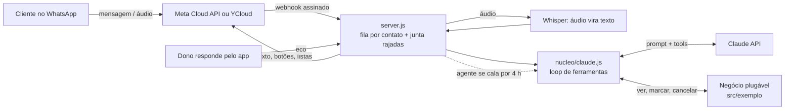

# Agente de WhatsApp com IA

Atendente virtual de WhatsApp feito com Claude (Anthropic). Ele conversa como uma pessoa da recepção, consulta a agenda, marca, lista e cancela horários, entende áudio e devolve a conversa para um humano quando o dono responde pelo app.

Criei o projeto para um cliente real, uma barbearia no Rio de Janeiro. Este repositório traz o **núcleo genérico** com um negócio fictício (o "Studio Exemplo"). A integração com o sistema de agenda do cliente e os dados dele ficam num repositório privado.

> **English summary:** WhatsApp customer-service agent built on Claude's tool use. It books, lists and cancels appointments, transcribes voice notes, and hands the chat back to a human when the owner replies from the WhatsApp Business app. It includes a business-agnostic core, verified webhooks, per-contact queues, encrypted state, prompt caching, cost tracking and 162 offline test checks. It was built for a real barbershop client; this public version ships a fictional business.

## Como funciona



O núcleo (`src/nucleo/`) não sabe qual negócio está atendendo. Cada negócio é uma pasta com a mesma interface: prompt, ferramentas e `runTool`. Para trocar de negócio, basta trocar a pasta.

## O que tem de interessante aqui

| Problema real | Solução |
| --- | --- |
| Cliente manda "oi", "quero cortar", "amanhã" em 3 mensagens | Junta a rajada em uma só (4 s) e responde uma vez |
| Duas mensagens chegam juntas e uma apaga a outra | Fila por contato: mesma pessoa em ordem, pessoas diferentes em paralelo |
| O dono quer continuar usando o app no mesmo número | Coexistência via YCloud: quando ele responde, o agente fica calado naquela conversa |
| Webhook é uma URL pública | Assinatura HMAC-SHA256 conferida em cada chamada |
| O modelo inventa horário | Toda resposta sobre horário passa por ferramenta; a agenda é a única fonte da verdade |
| Erro numa ferramenta derrubava a conversa | Erro vira instrução para o modelo seguir por outro caminho |
| Deploy apagava conversas em andamento | Estado cifrado em disco (AES-256-GCM), gravado no desligamento |
| Custo por mensagem invisível | Prompt caching no bloco estável e conta de custo por conversa no log |
| Resposta com cara de robô | Filtro de tom e botões e listas nativos do WhatsApp a partir de `[[opcoes: A \| B]]` |
| Agente opinando sobre saúde | Limite de saúde compartilhado, verificado por teste em todo prompt de negócio |

## Rodar

```bash
npm install
cp .env.example .env   # preencha ANTHROPIC_API_KEY e as chaves do WhatsApp
npm start
```

Testes (sem rede e sem chave de API):

```bash
npm test
```

Para publicar, há um `Dockerfile` pronto (usei o Railway). O endpoint `/health` mostra qual versão está no ar.

## Stack

Node.js 18+, Express, Anthropic SDK (Claude com tool use e prompt caching), WhatsApp Cloud API (Meta) e YCloud, Whisper para áudio, Docker.

## Autor

**Rodrigo Medeiros**: consultor de IA e automação, Rio de Janeiro. [LinkedIn](https://www.linkedin.com/in/rodrigo-r-244203161/)

Escrito com desenvolvimento assistido por IA (Claude Code), com revisão, testes e decisões de arquitetura meus.
