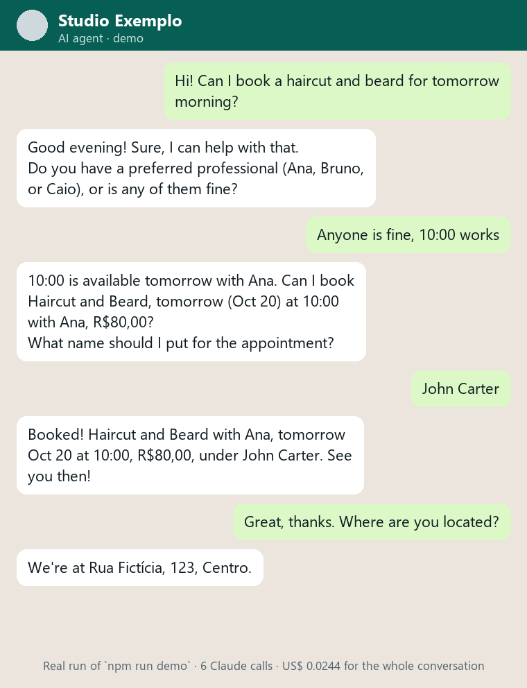
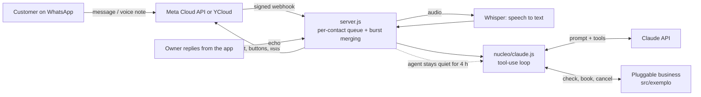

# AI WhatsApp Agent

[](https://github.com/rodrigomedeiros91-source/agente-whatsapp-ia/actions/workflows/tests.yml)

*[Leia em português](README.pt-BR.md)*



A WhatsApp customer-service agent built on Claude (Anthropic). It talks like a front-desk person, checks the calendar, books, lists and cancels appointments, understands voice notes, and hands the conversation back to a human when the business owner replies from the WhatsApp Business app.

I built it for a real client, a barbershop in Rio de Janeiro. This repository contains the **business-agnostic core** plus a fictional business ("Studio Exemplo"). The client's scheduling integration and data live in a private repository.

## How it works



The core (`src/nucleo/`) doesn't know which business it serves. Each business is a folder with the same interface: prompt, tools and `runTool`. Switching business means switching the folder.

## Engineering decisions

| Real problem | Solution |
| --- | --- |
| Customers send "hi", "want a haircut", "tomorrow" as 3 messages | Bursts are merged (4 s window) and answered once |
| Two messages arrive together and one overwrites the other | Per-contact queue: same person in order, different people in parallel |
| The owner wants to keep using the app on the same number | Coexistence via YCloud: when the owner replies, the agent goes quiet in that chat |
| The webhook is a public URL | HMAC-SHA256 signature checked on every call |
| The model invents time slots | Every answer about availability goes through a tool; the calendar is the single source of truth |
| A tool error used to kill the conversation | Errors become instructions for the model to take another path |
| Deploys wiped in-progress conversations | Encrypted state on disk (AES-256-GCM), saved on shutdown |
| Cost per message was invisible | Prompt caching on the stable block and per-conversation cost log |
| Robotic replies | Tone filter, plus native WhatsApp buttons and lists from `[[opcoes: A \| B]]` |
| An agent giving health advice | Shared health limit, enforced by a test on every business prompt |

## Run

```bash
npm install
cp .env.example .env   # fill in ANTHROPIC_API_KEY and the WhatsApp keys
npm start
```

Try the agent in your terminal, no WhatsApp needed (only `ANTHROPIC_API_KEY`):

```bash
npm run demo                                   # free chat
npm run demo -- "Hi! Can I book a haircut?"    # scripted, one message per argument
```

Tests (no network, no API key):

```bash
npm test
```

A `Dockerfile` is included (I deploy on Railway). The `/health` endpoint shows which version is live.

## Stack

Node.js 18+, Express, Anthropic SDK (Claude tool use and prompt caching), WhatsApp Cloud API (Meta) and YCloud, Whisper for audio, Docker.

## Author

**Rodrigo Medeiros**, AI & automation consultant, Rio de Janeiro. [LinkedIn](https://www.linkedin.com/in/rodrigo-r-244203161/)

Written with AI-assisted development (Claude Code); the review, tests and architecture decisions are mine. Code comments are in Portuguese, the language of the client and of the team that maintains it.
